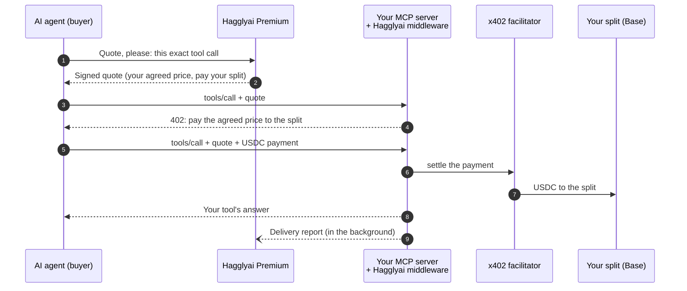
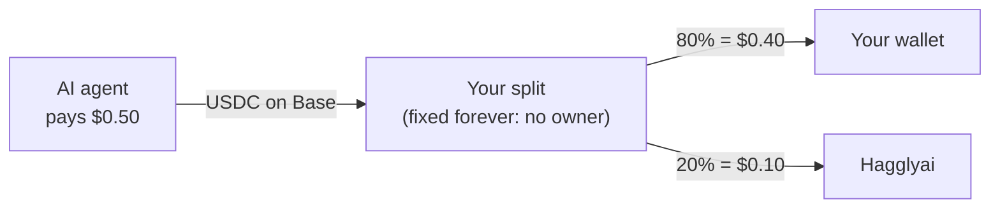

# Hagglyai Premium for MCP servers

**Get paid by AI agents that find you on [Hagglyai](https://hagglyai.com), with the commission settled
on chain, not on trust.**

You keep your MCP server, your prices and your ordinary traffic. When an agent comes through Hagglyai, it
pays your agreed price in USDC on Base into a **split**: a small contract that can only ever pay your
wallet and Hagglyai's, in the agreed shares. You never send Hagglyai an invoice, and Hagglyai never holds
your money.

| | |
|---|---|
| 📘 [**Provider guide**](docs/provider-guide.md) | Requirements, your split, installing the middleware, going live: about an hour |
| 🛠️ [**Troubleshooting**](docs/troubleshooting.md) | Every error you can see, what it means, how to fix it |
| 🧩 [**Examples**](#examples) | Runnable MCP servers with Premium built in, with tests |

## How it works



1. The agent asks Hagglyai for a quote for one exact tool call.
2. Your middleware checks the quote (signature, price, your split, the exact request) **before** anything
   is paid, and asks for the agreed price, payable only to your split.
3. The agent pays, your tool answers, and your server tells Hagglyai the call was delivered.

## Where the money goes



- The split's shares are fixed when it is created. Nobody, Hagglyai included, can change who it pays.
- Money builds up in the split. At **$5** Hagglyai pays it out on chain, **and pays the gas**.
- *The 80/20 above is an example: the commission is whatever you agree.*

## What stays the same

- **Your ordinary traffic.** Calls without a Hagglyai quote are charged your normal price, to your normal
  wallet, as now.
- **Your rankings.** Hagglyai's comparison never reads commercial data: taking part does not move you up,
  and leaving does not move you down.
- **Failed calls are free.** If your tool fails, the agent is not charged.

## Examples

| Example | What it shows |
|---|---|
| [`examples/mcp-sdk`](examples/mcp-sdk/) | **Start here.** The pattern from the provider guide: an MCP server built with the official MCP SDK, on **Hono** (Cloudflare Workers, Node, Bun, Deno) or **Express** (Node), with only its paid tools behind Premium |
| [`examples/docx2md`](examples/docx2md/) | A complete paid MCP service (Word to Markdown) with storage, background jobs, `diagnose()` and a buyer script. Used for Hagglyai's first real end-to-end payout on Base |

```sh
git clone https://github.com/mckenziefuk/hagglyai-premium-mcp
cd hagglyai-premium-mcp
npm install
npm test          # every example, end to end, with a fake facilitator: no chain, no money
```

The tests need Node 22.5 or later (and `python3` for the docx2md example).

## Packages

- [`@hagglyai/premium-x402`](https://www.npmjs.com/package/@hagglyai/premium-x402): the middleware
  (Hono and Express), durable state, diagnostics and the buyer helper
- [`@hagglyai/premium-protocol`](https://www.npmjs.com/package/@hagglyai/premium-protocol): quotes,
  agreements and request digests
- Integration guide for any x402 API (not only MCP): [premium.hagglyai.com/guide](https://premium.hagglyai.com/guide)

## Contact

Questions, or ready to start: **hello@hagglyai.com**.

MIT licensed.
