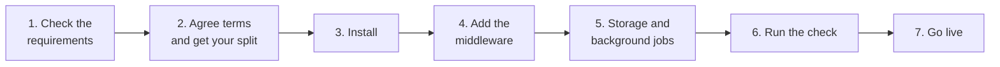
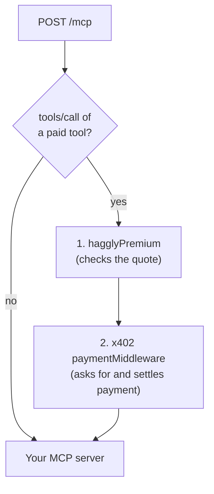

# Provider guide: add Hagglyai Premium to your MCP server

About **an hour** of work, most of it copy and paste. You need nothing from Hagglyai to start steps 3 to 5;
Hagglyai sends you the last few settings (step 2) while you build.



---

## 1. Requirements

| You need | Why | Notes |
|---|---|---|
| **An MCP server over HTTP** (Streamable HTTP, `POST /mcp`) | Agents call it over the internet | Not stdio. Paid calls must answer JSON, not a stream (shown below) |
| **JavaScript or TypeScript** on Node 20+, Cloudflare Workers, Bun or Deno | The middleware is an npm package | Python servers are not supported yet |
| **Hono or Express** in front of your MCP handler | The middleware plugs into either | Other frameworks: talk to us |
| **A public `https://` URL** | Quotes are only issued for https | One origin, e.g. `https://mcp.example.com` |
| **A wallet on Base** for your share | Your earnings are paid to it | Any wallet you control. No ETH needed |
| **An x402 facilitator for Base mainnet** | Settles each payment | Any facilitator whose `/supported` list includes the `exact` scheme on `eip155:8453` |
| **A Base RPC URL** | Rare checks of uncertain payments | Any Base mainnet endpoint reachable from where your server runs. Prefer one with your own key: free public endpoints rate-limit |
| **A small SQL database** | Each quote is paid once; deliveries are reported reliably | Cloudflare D1, SQLite (built in), or any SQL database |

---

## 2. Agree terms and get your split

Email **hello@hagglyai.com** with:

| | Example |
|---|---|
| Your server's public URL | `https://mcp.example.com` (origin only) and the path, usually `/mcp` |
| Which tools are paid | `word_count`, `summarise` |
| Your price per paid call | $0.50 (one price for all paid tools on one URL) |
| Your wallet on Base | `0x1234…abcd` |

### The split: the easy way

**Hagglyai creates the split for you.** You send your wallet address; Hagglyai creates a split on Base that
pays your wallet and Hagglyai's in the agreed shares, and sends you its address. It has no owner, so
nobody can ever change it. That is all you have to do. Check it on Basescan if you like (below).

<details>
<summary><b>Prefer to create it yourself?</b> (about 2 minutes, a few cents of gas)</summary>

1. Open [app.splits.org](https://app.splits.org), connect a wallet, and switch to **Base**.
2. **New contract → Split**.
3. Recipients: your wallet with your share (e.g. **80%**), Hagglyai's wallet with the commission
   (e.g. **20%**). Hagglyai gives you its wallet address.
4. **Distribution: Push.** This is the one setting that matters. The app may default to *Pull*, which
   leaves payouts in the Splits Warehouse; Hagglyai refuses a pull split.
5. **Distributor fee: 0%.** **Controller: none** (immutable).
6. Create it and send Hagglyai the split's address.

If the app shows no Push option, or your wallet refuses the transaction, ask Hagglyai to create it.

</details>

**Checking a split** (optional): open `https://basescan.org/address/<split address>`. It is a contract
created by the Splits push factory `0x8E8e…3Ecf4`. Hagglyai's premium service checks it on chain anyway
before any quote is issued: push split, no owner, not paused, exactly your agreed shares, no fee.

### What Hagglyai sends you

Once the split is checked, you receive four settings. Keep the events token secret.

| Setting | What it is |
|---|---|
| `HAGGLY_PROVIDER_ID` | Your id in quotes, e.g. `acme-mcp` |
| `HAGGLY_AGREEMENT` | Your agreement as JSON: price, commission, split, wallets |
| `HAGGLY_JWKS` | Hagglyai's public signing keys (also at `https://premium.hagglyai.com/.well-known/jwks.json`) |
| `HAGGLY_EVENTS_TOKEN` | **Secret.** Lets your server report deliveries |

---

## 3. Install

```sh
npm install @hagglyai/premium-x402 @hagglyai/premium-protocol @x402/core @x402/evm @modelcontextprotocol/sdk zod viem
npm install hono @x402/hono          # Hono (Cloudflare Workers, Node, Bun, Deno)
npm install express @x402/express    # or Express (Node)
```

---

## 4. Add the middleware

The idea in one picture: only **paid tool calls** go through the payment checks. Everything else
(`initialize`, `tools/list`, free tools) goes straight to your MCP server, free.



### 4a. Your MCP server, unchanged, plus one function

Build your server with the official MCP SDK as usual, and answer each request with a fresh server and
transport (stateless) and **JSON responses**. A tool error is answered **422**, so a failed paid call is
never charged. Full file: [`examples/mcp-sdk/mcp.ts`](../examples/mcp-sdk/mcp.ts).

```ts
import { McpServer } from "@modelcontextprotocol/sdk/server/mcp.js";
import { WebStandardStreamableHTTPServerTransport } from "@modelcontextprotocol/sdk/server/webStandardStreamableHttp.js";

export const PAID_TOOLS = ["word_count"];                       // ← your paid tools

export function isPaidCall(message: unknown): boolean {
  const m = message as { method?: unknown; params?: { name?: unknown } } | null;
  return m?.method === "tools/call" && PAID_TOOLS.includes(String(m.params?.name));
}

function buildServer() {
  const server = new McpServer({ name: "my-server", version: "1.0.0" });
  // server.registerTool(...)  ← your tools, as today
  return server;
}

export async function handleMcp(request: Request): Promise<Response> {
  const transport = new WebStandardStreamableHTTPServerTransport({ sessionIdGenerator: undefined, enableJsonResponse: true });
  await buildServer().connect(transport);
  const res = await transport.handleRequest(request);
  if (res.status !== 200 || !res.headers.get("content-type")?.includes("application/json")) return res;
  const body = await res.text();
  const failed = (JSON.parse(body) as { result?: { isError?: boolean } }).result?.isError === true;
  return new Response(body, { status: failed ? 422 : 200, headers: res.headers });  // failed calls are free
}
```

### 4b. The Hagglyai partner (the same for Hono and Express)

```ts
import { Agreement } from "@hagglyai/premium-protocol";
import { createHagglyPartner, importPinnedKeys } from "@hagglyai/premium-x402";
import { HTTPFacilitatorClient, x402ResourceServer } from "@x402/core/server";
import { ExactEvmScheme } from "@x402/evm/exact/server";

const partner = createHagglyPartner({
  providerId: env.HAGGLY_PROVIDER_ID,
  issuer: "https://premium.hagglyai.com",
  keys: await importPinnedKeys(JSON.parse(env.HAGGLY_JWKS)),
  agreement: Agreement.parse(JSON.parse(env.HAGGLY_AGREEMENT)),
  store,    // step 5
  outbox,   // step 5
});
const server = partner.attach(
  new x402ResourceServer(new HTTPFacilitatorClient({ url: env.FACILITATOR_URL }))   // your facilitator for Base mainnet
    .register("eip155:8453", new ExactEvmScheme()),
);
// Your ordinary x402 price and wallet, for callers without a Hagglyai quote:
const routes = {
  "POST /mcp": { accepts: { scheme: "exact", network: "eip155:8453", payTo: env.PROVIDER_WALLET, price: "$0.60" } },
};
```

### 4c. Hono (Cloudflare Workers, Node, Bun, Deno)

Full file: [`examples/mcp-sdk/hono.ts`](../examples/mcp-sdk/hono.ts).

```ts
import { hagglyPremium } from "@hagglyai/premium-x402/hono";
import { paymentMiddleware } from "@x402/hono";
import { Hono } from "hono";
import { every } from "hono/combine";

const paid = every(hagglyPremium(partner), paymentMiddleware(partner.routes(routes), server)); // this order

const app = new Hono();
app.post(
  "/mcp",
  async (c, next) => {
    const message = await c.req.raw.clone().json().catch(() => null);
    return isPaidCall(message) ? paid(c, next) : next();
  },
  (c) => handleMcp(c.req.raw),
);
```

### 4d. Express (Node)

Full file: [`examples/mcp-sdk/express.ts`](../examples/mcp-sdk/express.ts) (includes the small
`toRequest` helper).

```ts
import { captureRawBody, hagglyPremium } from "@hagglyai/premium-x402/express";
import { paymentMiddleware } from "@x402/express";
import express from "express";

const app = express();
app.use(express.json({ verify: captureRawBody }));   // a quote covers the exact body bytes

const paid = express.Router();
paid.use(hagglyPremium(partner), paymentMiddleware(partner.routes(routes), server)); // this order

app.post(
  "/mcp",
  (req, res, next) => (isPaidCall(req.body) ? paid(req, res, next) : next()),
  async (req, res) => {
    const answer = await handleMcp(toRequest(req));
    res.status(answer.status);
    answer.headers.forEach((v, k) => res.setHeader(k, v));
    res.send(Buffer.from(await answer.arrayBuffer()));
  },
);
```

> **Three things to get right.** `hagglyPremium` comes **before** `paymentMiddleware`.
> `partner.attach(server)` and `partner.routes(routes)` are both needed: they make a quoted call pay only
> your split, at the agreed price. On Express, `captureRawBody` must be on the JSON parser.

---

## 5. Storage and background jobs

Create the two state tables once (a migration), then run two jobs every few minutes, **never in the
request path**.

**Cloudflare Workers (D1):**

```ts
import { eip3009AuthorizationUsed } from "@hagglyai/premium-x402";
import { d1Executor, deliverOutbox, SqlOutbox, SqlQuoteStore } from "@hagglyai/premium-x402/sql";
import { createPublicClient, http } from "viem";
import { base } from "viem/chains";

const sql = d1Executor(env.DB);
const store = new SqlQuoteStore(sql);
const outbox = new SqlOutbox(sql);
// Run PROVIDER_SCHEMA (from "@hagglyai/premium-x402/sql") once as a D1 migration.

export default {
  fetch: (req: Request) => app.fetch(req),
  async scheduled() {   // cron trigger, e.g. every 5 minutes
    const chain = createPublicClient({ chain: base, transport: http(env.BASE_RPC_URL) });
    for (const jti of await store.uncertain()) await partner.reconcile(jti, eip3009AuthorizationUsed(chain));
    await deliverOutbox({ sql, premiumUrl: "https://premium.hagglyai.com", eventsToken: env.HAGGLY_EVENTS_TOKEN });
  },
};
```

**Node (SQLite, built in):**

```ts
import { DatabaseSync } from "node:sqlite";
import { deliverOutbox, PROVIDER_SCHEMA, SqlOutbox, SqlQuoteStore, sqliteExecutor } from "@hagglyai/premium-x402/sql";
const db = new DatabaseSync("haggly-state.db");
db.exec(PROVIDER_SCHEMA);
const sql = sqliteExecutor(db);
const store = new SqlQuoteStore(sql);
const outbox = new SqlOutbox(sql);
setInterval(async () => { /* the same two lines as above */ }, 5 * 60 * 1000);
```

- **`deliverOutbox`** tells Hagglyai which calls were delivered. It retries by itself; resending is harmless.
- **`reconcile`** settles the rare payment whose outcome was unclear (a facilitator timeout) by asking
  Base. A buyer is never asked to pay twice.

---

## 6. Run the check

`diagnose()` checks your keys, storage and middleware order. It sends one fake premium call to your paid
tool, which must be refused with `401 quote_invalid`. It buys nothing.

```ts
import { diagnose } from "@hagglyai/premium-x402/diagnose";
const report = await diagnose({
  keys, store, outbox,
  premiumUrl: "https://premium.hagglyai.com",
  app: (r) => app.fetch(r),                 // Express: (r) => fetch(r) against your running server
  probeUrl: "https://mcp.example.com/mcp",
  probeMethod: "POST",
  probeBody: JSON.stringify({ jsonrpc: "2.0", id: "diagnose", method: "tools/call", params: { name: "word_count", arguments: { text: "x" } } }),
});
for (const c of report.checks) console.log(c.status, c.name, c.detail);
```

Every line should start with `ok`. If not, see [Troubleshooting](troubleshooting.md).

---

## 7. Go live

1. Deploy, and tell Hagglyai the `diagnose()` output.
2. Hagglyai makes one real paid call to your server and checks it end to end with you.
3. You are live. Hagglyai can now quote your paid tools to agents.

**After that:**
- Ordinary calls keep paying your normal price to your normal wallet.
- Premium calls pay your split; at $5 it pays out (your share to your wallet, Hagglyai pays the gas).
- During the pilot, quotes are capped per day (500 quotes and $25 by default). An agent over a cap is
  told before paying anything.

## Questions

**Do I need ETH?** No. The facilitator pays settlement gas, and Hagglyai pays payout gas.

**Can I change my price later?** Yes. Hagglyai adds a new agreement version (and, if the commission
changes, a new split). Quotes already issued keep their terms.

**What if Hagglyai disappears?** Your split still pays out: anyone can trigger a payout of a push split,
and it can only ever pay your wallet and Hagglyai's.

**Is a refund possible?** If a call was paid but not answered, the middleware records it and Hagglyai is
told. Your refund policy applies; the buyer is never charged twice for the same quote.

**What do agents need?** An x402 client on Base and a quote from Hagglyai. Hagglyai's buyer helper
(`premiumFetch` in `@hagglyai/premium-x402/client`) sends the quote with each attempt and refuses to pay
unless your 402 matches it.
