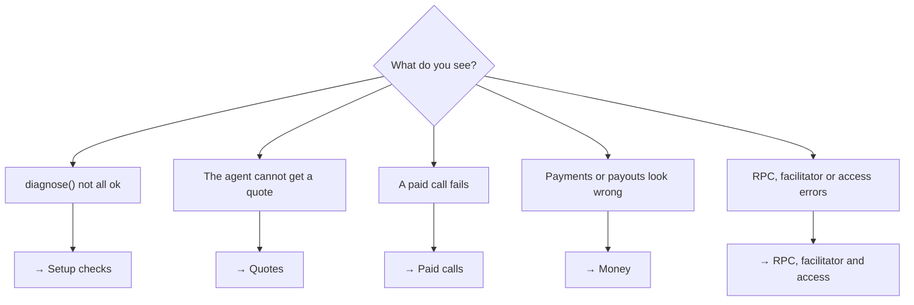

# Troubleshooting

Find the symptom, then the fix. Error names are exactly what the API returns. Still stuck? Email
**hello@hagglyai.com** with the error, the time, and the request id or quote id if you have one.

## Setup checks (`diagnose()`)

| You see | Meaning | Fix |
|---|---|---|
| `middleware order: fail … unexpected 402` | The fake premium call reached the payment middleware before the quote check | Put `hagglyPremium` **before** `paymentMiddleware`. Check the probe calls one of your `PAID_TOOLS` and that `isPaidCall` sends it through `paid` |
| `middleware order: fail … unexpected 200` | The paid tool was not gated at all | The tool name in `probeBody` is missing from `PAID_TOOLS`, or the gate is not on `POST /mcp` |
| `raw_body_missing` (500) | Express parsed the body without keeping the raw bytes | `app.use(express.json({ verify: captureRawBody }))` before the gate |
| `premium key set: … stale` | Hagglyai published a new signing key | Copy `https://premium.hagglyai.com/.well-known/jwks.json` into `HAGGLY_JWKS` again and redeploy |
| `quote store: … in memory` | You are using the test-only store | Use `SqlQuoteStore` and `SqlOutbox` (step 5) |
| `x402 version` warning | Your `@x402/*` packages are not 2.28 | Install `@x402/*@2.28` |

## Quotes (the agent asks Hagglyai and is refused)

| Error | Meaning | Fix |
|---|---|---|
| `unknown_provider` (404) | No provider at that origin | The URL must match your registered origin exactly: `https`, same host (no `www.` difference), no port |
| `unknown_endpoint` (404) | That method and path are not registered | Usually `POST /mcp`. Ask Hagglyai to add the path you actually serve |
| `split_unverified` / `no_agreement` (409) | Your agreement is not ready | Hagglyai has not finished step 2. Ask Hagglyai |
| `provider_suspended` (409) | Quotes for you are switched off | Contact Hagglyai |
| `over_budget` (422) | Your price is above the agent's budget | Nothing to fix on your side |
| `cap_reached` (429) | A daily pilot cap was reached (UTC day) | Wait for tomorrow, or ask Hagglyai to raise your cap. Nothing was charged |
| `quotes_paused` (503) | Hagglyai has paused all new quotes | Temporary. Watch for Hagglyai's message |

## Paid calls (your server answers with an error)

| Error | Meaning | Fix |
|---|---|---|
| `quote_invalid` (401) | Bad signature, unknown key, wrong issuer or audience, or expired | Quotes last at most 5 minutes. Check `HAGGLY_JWKS`, that `issuer` is `https://premium.hagglyai.com` (not staging), and that `HAGGLY_PROVIDER_ID` is yours |
| `quote_mismatch` with `problems: ["request"]` (409) | The call is not byte-for-byte the call that was quoted | Something changed the body or path on the way: a proxy that re-formats JSON, a different JSON-RPC `id`, or a rewritten path. Pass the body through untouched |
| `quote_mismatch` with agreement terms (409) | Your `HAGGLY_AGREEMENT` is out of date | Hagglyai added a new agreement version: copy the new JSON and redeploy |
| `quote_reused` (409) | A quote used for a different call | Each quote is for one call. The agent needs a new quote |
| `quote_used` (409) | Already paid for | A retry with the same payment gets the stored answer (header `haggly-replay: 1`). Nothing to fix |
| `payment_in_progress` (409) | The same quote is being paid by another request right now | Retry in a moment. Nobody pays twice |
| `settlement_uncertain` (409) | The facilitator timed out; the payment may have gone through | Do not pay again. Your `reconcile` job settles it from the chain within minutes |
| `charged_undelivered` (409) | Paid, but your server did not answer | Your refund policy applies. Hagglyai is told automatically |
| `premium_option_only` / `payer_mismatch` | Payment to the wrong address, or from someone other than the quoted payer | The agent's client is misbehaving. `premiumFetch` never does this |
| The 402 offers **your normal wallet**, not the split | The quote did not reach the middleware, or `partner.routes()` is missing | Make sure `paymentMiddleware(partner.routes(routes), …)` wraps your routes, and that no proxy strips the `Haggly-Premium` header |
| A failed tool call **was charged** | The tool error answered HTTP 200 | Use `handleMcp` from step 4a: it answers 422 for `isError`, and x402 only charges below 400 |
| Response is `text/event-stream` | Paid calls must answer JSON | `enableJsonResponse: true` on the transport |

## Money

| Symptom | Meaning | Fix |
|---|---|---|
| Hagglyai sees no deliveries | Your outbox is not reaching Hagglyai | Is the background job running? A `401` from `/v1/events` means `HAGGLY_EVENTS_TOKEN` is wrong: ask Hagglyai for a new one. Undelivered events wait in the `haggly_outbox` table and are retried |
| A delivery shows as "checking" | Hagglyai confirms each payment on Base | Normal for about 10 minutes |
| A delivery shows "mismatch" or "not found" | The payment on chain does not match the report | Contact Hagglyai with the time of the call |
| No payout yet | Payouts start at **$5** in the split | Check the split's USDC balance on Basescan |
| Payout went to the "Splits Warehouse" | It is a **pull** split | Hagglyai refuses pull splits for new agreements. Recipients of an old pull split can withdraw at app.splits.org |

**When Hagglyai sets up your split** (in the admin panel), these refusals can appear:

| Error | Fix |
|---|---|
| `split_check_failed`: "not a Splits V2.2 push split" | Create the split again with **Push** distribution |
| `split_check_failed`: "has an owner" / "is paused" | Create it again with **no controller** |
| `split_check_failed`: "does not pay …" | The wallets, the shares or the distributor fee differ from the agreement. Fee must be 0% |
| `split_check_failed`: "no contract at the split address" | Wrong address, or the creation transaction failed |
| `split_check_unavailable` (503) | Hagglyai could not read Base just then | Try again. Persistent: Hagglyai's RPC needs attention |

## RPC, facilitator and access

How you host your server is up to you; these are the parts of your set-up that Premium depends on.

| Symptom | Cause | Fix |
|---|---|---|
| Agents get a **login page** or `401`/`403` from your server | An authentication layer in front of your MCP URL | Paid calls must reach `/mcp` without a login: agents pay instead of signing in |
| RPC errors **525** from Cloudflare Workers | Alchemy refuses requests from Workers | Use Coinbase CDP's Base node (`https://api.developer.coinbase.com/rpc/v1/base/<key>`) |
| RPC errors **429** | Free public RPCs rate-limit shared addresses | Use your own RPC key (Coinbase CDP's is free) |
| "Invalid URL" around the RPC | The setting holds only the key, not the URL | Set the whole URL, starting `https://` |
| Facilitator rejects payments | It does not support Base mainnet (`eip155:8453`) | Use PayAI (`https://facilitator.payai.network`) or Coinbase CDP's facilitator |
