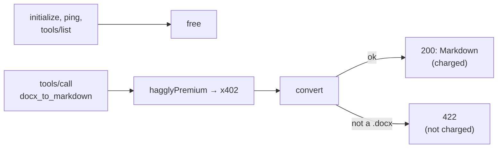

# docx2md: a complete paid MCP service

A small, real MCP server with one paid tool, `docx_to_markdown`, which converts a Word document to
Markdown with [`docx2md.py`](docx2md.py) (Python standard library only). It is the service Hagglyai used
for its first real end-to-end payout on Base: ten paid calls through a hosted facilitator into a Splits
push split, delivered, confirmed on chain and paid out.

Use it as a second, fuller example next to [`examples/mcp-sdk`](../mcp-sdk/): it adds durable storage,
background jobs, `diagnose()` on start-up, and a buyer script.

| File | What it is |
|---|---|
| [`app.ts`](app.ts) | The MCP server (Streamable HTTP, stateless, JSON responses), hand-written so every byte is visible, with Premium in front of the paid tool |
| [`server.ts`](server.ts) | Runs it on Node: SQLite state, `diagnose()`, the outbox and reconcile jobs |
| [`buy.ts`](buy.ts) | A buyer: quotes and pays for calls. **Spends real USDC** |
| [`docx2md.py`](docx2md.py) | The converter: headings, emphasis, links, lists, tables, footnotes, images |

## How payment fits MCP



- MCP sends every message to `POST /mcp`, so payment is decided from the JSON-RPC body.
- A quote covers the exact body bytes, including the JSON-RPC `id`: the buyer builds the body
  (`toolCallBody`), gets a quote for it, and sends exactly those bytes.
- A conversion that fails answers HTTP 422, so it is never charged (x402 settles only below 400).

## Run the tests (no chain, no money)

```sh
npm test    # test/docx2md.test.ts: free methods, ordinary 402, a paid call into the split with replay, mismatch refused, failure not charged
```

## Run it for real

You need the settings Hagglyai sends you (see the [provider guide, step 2](../../docs/provider-guide.md#what-hagglyai-sends-you))
and a public `https://` URL for your server, hosted however you like.

1. Put your settings in a file only you can read (`chmod 600`), never in the repository:

   ```sh
   HAGGLY_PROVIDER_ID=your-id
   HAGGLY_AGREEMENT={"id":"…","version":1,…}
   HAGGLY_JWKS={"keys":[…]}            # from https://premium.hagglyai.com/.well-known/jwks.json
   HAGGLY_EVENTS_TOKEN=…               # secret
   PROVIDER_WALLET=0x…                 # your wallet, for ordinary (non-premium) calls
   FACILITATOR_URL=https://facilitator.payai.network
   BASE_RPC_URL=https://api.developer.coinbase.com/rpc/v1/base/<your key>
   ORDINARY_PRICE=$0.60
   PORT=8787
   ```

2. Start it:

   ```sh
   node --env-file=/path/to/your.env --import tsx examples/docx2md/server.ts
   ```

   Every `diagnose:` line should say `ok`, including **middleware order**.

3. Make it reachable at your public URL, with `POST /mcp` open to agents (no login in front of it).

4. Make a paid call from a wallet holding only a few USDC on Base (key in a `chmod 600` file):

   ```sh
   env BUYER_KEY_FILE=$HOME/buyer.key MCP_URL=https://your.domain/mcp DOCX=some.docx \
       MAX_AMOUNT_ATOMIC=500000 CALLS=1 npx tsx examples/docx2md/buy.ts
   ```

   Expect `quoted … to <your split>`, then `200 … settled: true` and the Markdown.
