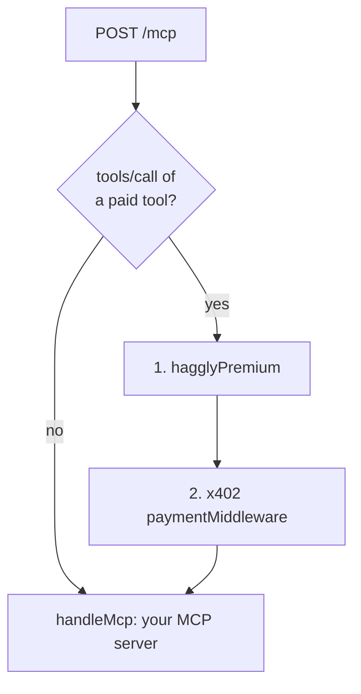

# MCP SDK example (Hono or Express)

The pattern from the [provider guide](../../docs/provider-guide.md), built with the official
[MCP TypeScript SDK](https://github.com/modelcontextprotocol/typescript-sdk). Copy the parts you need.

| File | What it is |
|---|---|
| [`mcp.ts`](mcp.ts) | Your MCP server and its tools, unchanged, plus `handleMcp(request)`: stateless, JSON responses, and a failed tool answered 422 so it is never charged. `PAID_TOOLS` lists the tools that cost money |
| [`hono.ts`](hono.ts) | Hono (Cloudflare Workers, Node, Bun, Deno): only a paid `tools/call` goes through `hagglyPremium` and then the x402 middleware |
| [`express.ts`](express.ts) | The same on Express (Node), with `captureRawBody` so the quote can check the exact body |
| [`buy.ts`](buy.ts) | One real premium call to any MCP tool. **Spends real USDC**: for the go-live test |



`createPaidMcpApp` (Hono) and `createPaidMcpExpressApp` (Express) take the Hagglyai partner and the x402
resource server built as in the [provider guide, step 4b](../../docs/provider-guide.md#4b-the-hagglyai-partner-the-same-for-hono-and-express).

## Tests

[`test/mcp-sdk.test.ts`](../../test/mcp-sdk.test.ts) runs five scenarios on both frameworks, with quotes
signed by a throwaway key and a fake facilitator (no chain, no money):

- `tools/list` is free;
- a call without a quote is asked for your ordinary price, paid to your wallet;
- a quoted call is paid into the split once, answered and reported;
- a call whose tool fails answers 422 and is not charged;
- a quote for a different call is refused before any payment.

```sh
npm test
```

## The go-live call

```sh
BUYER_KEY_FILE=~/buyer.key MCP_URL=https://mcp.example.com/mcp \
TOOL=word_count ARGS='{"text":"hello world"}' MAX_AMOUNT_ATOMIC=500000 npx tsx examples/mcp-sdk/buy.ts
```

Use a wallet holding only a few USDC, and keep its key in a file only you can read (`chmod 600`).
